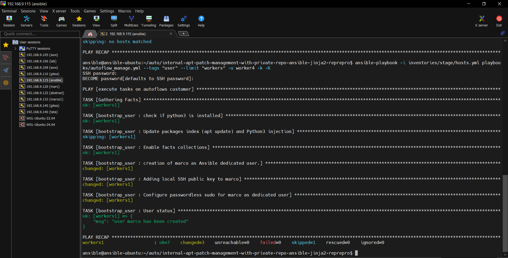
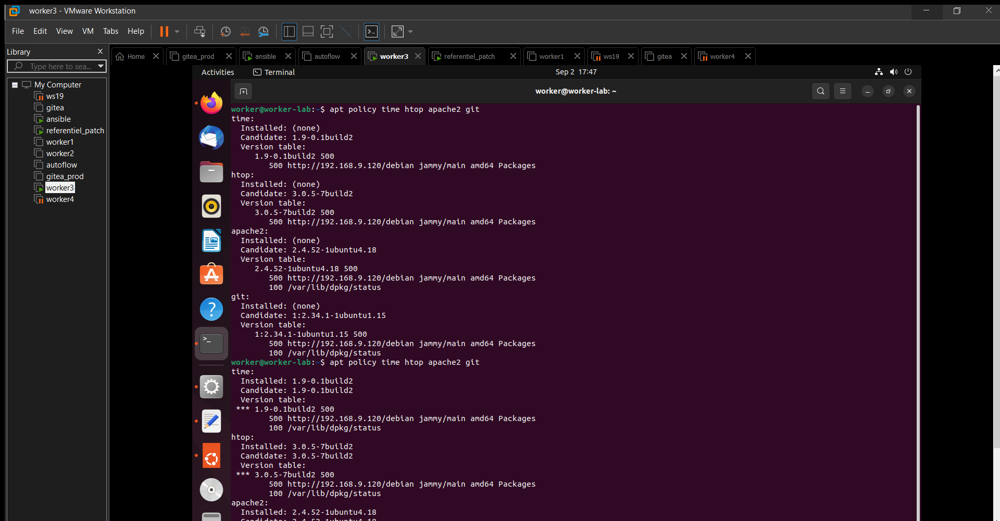
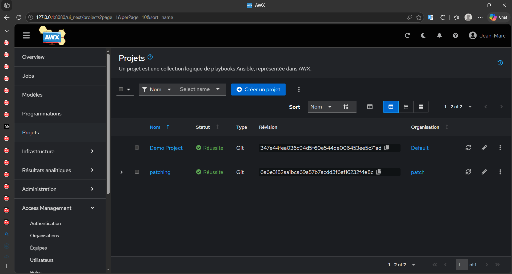
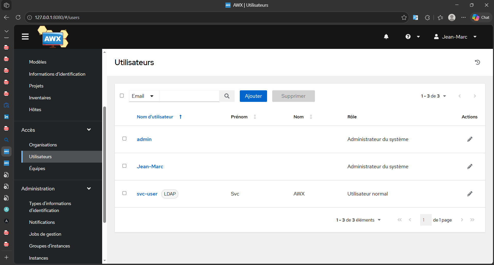

<h1 align="center"> Centralized Linux Patch Management & Infrastructure Automation </h1>

## 1. Problem Statement

Managing Linux systems in an IT infrastructure involves several challenges, particularly in package management, system configuration, security and operational consistency.

Allowing Linux clients to retrieve packages directly from external repositories can make it difficult to control package sources, versions, integrity and distribution.

Additionally, managing system configurations and administrative tasks across multiple machines manually can lead to inconsistencies and increase operational workload.

User authentication and access management also require centralized control to ensure that only authorized users can access administration tools.

This project addresses these challenges through:

- A private APT repository for controlled package distribution.
- Ansible automation for Linux configuration and patch management.
- AWX and Gitea for centralized automation and source code management.
- Windows Server Active Directory and LDAP for centralized user authentication and access management.

## 2. Project Overview

This project implements a centralized Linux package management and infrastructure automation environment using Ansible.

Linux clients retrieve approved packages and dependencies from a private APT repository instead of accessing external repositories directly.

The infrastructure is organized into two environments: **Staging** and **Production**.

The lab also integrates AWX, Gitea and Windows Server Active Directory to centralize automation, source code management, authentication and access control.

## 3. Infrastructure Architecture

### Global Architecture

```bash
                         INTERNET
                            |
                            v
                  Official APT Repository
                            |
                            v
                   +------------------+
                   |   PRIVATE APT   |
                   |   REPOSITORY    |
                   |    Reprepro     |
                   +--------+---------+
                            |
                         HTTP / APT
                            |
                    +-------+-------+
                    |               |
                    v               v
                +-------+       +-------+
                | STAGE |       |  PROD |
                | Linux |       | Linux |
                +---+---+       +---+---+
                    ^               ^
                    |               |
                    +-------+-------+
                            |
                         Ansible
                            |
                           AWX
                         /     \
                        v       v
                     Gitea    Active
                             Directory
                               LDAP
```

### Main Components

| Component | Purpose |
|---|---|
| Reprepro | Private APT repository management |
| Linux Clients | Managed systems receiving packages |
| Ansible | Configuration and automation |
| AWX | Centralized playbook execution |
| Gitea | Git repository hosting |
| Windows Server AD | Centralized identity management |
| LDAP | Authentication between AD and AWX |

### Main Workflows

- **Package Management:** Official APT Repository → Private Repository → Linux Clients.
- **Automation:** Gitea → AWX → Ansible → Linux Clients.
- **Authentication:** Active Directory → LDAP → AWX.

**Package management policy:** Linux clients use the internal repository as their authorized package source. External package retrieval is handled by the repository server.

## 4. Implemented Features

| Area | Features |
|---|---|
| APT Management | Private repository, package distribution, dependency management |
| Security | SHA256 verification, Ansible Vault, SSH hardening |
| Linux Administration | Dedicated user management, package installation, configuration backup and restoration |
| Automation | Ansible playbooks and reusable roles |
| Orchestration | AWX inventories, credentials and job templates |
| Version Control | Gitea repository hosting and AWX synchronization |
| Identity Management | Windows Server Active Directory and LDAP authentication |
| Access Control | AWX users, teams and inventory permissions |
| Environments | Separate Staging and Production inventories |

## 5. Technologies

| Category | Technologies |
|---|---|
| Operating Systems | Ubuntu / Linux, Windows Server |
| Automation | Ansible |
| Package Management | APT, Reprepro |
| Orchestration | AWX |
| Version Control | Git, Gitea |
| Authentication | Active Directory, LDAP |
| Security | SSH, Ansible Vault |
| Virtualization | VMware Workstation |

## 6. Project Structure

```bash
autoflow/
├── helper/
├── Images/
├── inventories/
│   ├── group_vars/
│   ├── prod/
│   └── stage/
├── logs/
├── playbooks/
│   └── autoflow_manage.yml
├── roles/
│   ├── bootstrap_user/
│   ├── packages/
│   ├── machine-local-apt/
│   ├── rollback/
│   └── ssh_hardening/
├── Videos/
├── .gitignore
├── ansible.cfg
└── README.md
```

## 7. Execution Environment

Ansible manages Linux clients through SSH.

### Prerequisites

| Control Node | Managed Linux Nodes |
|---|---|
| Linux operating system | Linux operating system |
| Ansible installed | Python 3 |
| OpenSSH client | OpenSSH server |
| SSH key pair | SSH connectivity |

### Ansible Commands

**Test connectivity**

```bash
ansible workers -i inventories/stage/hosts.yml -m ping
```

**Create dedicated user**

```bash
ansible-playbook -i inventories/stage/hosts.yml playbooks/autoflow_manage.yml --tags "user" --limit "workers" -u worker4 -k -K
```

**Apply SSH hardening**

```bash
ansible-playbook -i inventories/stage/hosts.yml playbooks/autoflow_manage.yml --tags "ssh" --limit "all:!local"
```

**Configure internal APT repository**

```bash
ansible-playbook -i inventories/stage/hosts.yml playbooks/autoflow_manage.yml --tags "apt" --limit "workers"
```

**Install packages**

```bash
ansible-playbook -i inventories/stage/hosts.yml playbooks/autoflow_manage.yml --tags "install_packages" --limit "autoflows"
```

## 8. AWX & Gitea Integration

Gitea and AWX are integrated to manage project source code and Ansible execution.

| Step | Operation |
|---|---|
| 1 | Project repository hosted in Gitea |
| 2 | AWX synchronizes the repository |
| 3 | Inventories and credentials configured in AWX |
| 4 | Job templates created |
| 5 | Ansible playbooks executed through AWX |

## 9. Windows Server Active Directory & LDAP Integration

Windows Server Active Directory is integrated with AWX through LDAP authentication.

This integration allows centralized user authentication and access management.

### Authentication Workflow

1. A user account is created in Active Directory.
2. AWX authenticates the user through LDAP.
3. The AWX administrator assigns the appropriate permissions.
4. The user accesses authorized AWX resources.

### Access Management

- Centralized user authentication.
- LDAP integration with AWX.
- AWX user and team management.
- Inventory access permissions.

## 10. Demonstrations

### Linux Administration & Ansible



### APT Repository Configuration


### Package Management



### AWX & Gitea Integration



### Active Directory & LDAP Integration



## 11. Project Status

- **Operational:** Private APT Repository, Ansible Roles, AWX, Gitea and Active Directory / LDAP Integration.
- **Under Review:** Ansible Rollback Role.
- **Planned:** Prometheus and Grafana Monitoring.


## 12. Related Project

👉 [Private local repository seting up](https://github.com/jeanmarctsh/http-linux-local-repository)


## Project Evolution

This project remains open to future improvements, including:

- Rollback role refinement.
- Prometheus and Grafana monitoring integration.
- Extension of Ansible automation to additional Linux administration tasks.
- Further improvements to SSH access controls and credential management.

---

## ✍️ AUTHOR

- Nom : Ngandu Jean-Marc
- [](mailto:jeanmarctshimbombo@gmail.com)
- [](https://www.linkedin.com/in/jean-marc-ngandu-b60796222)
- [](https://github.com/jeanmarctsh)


